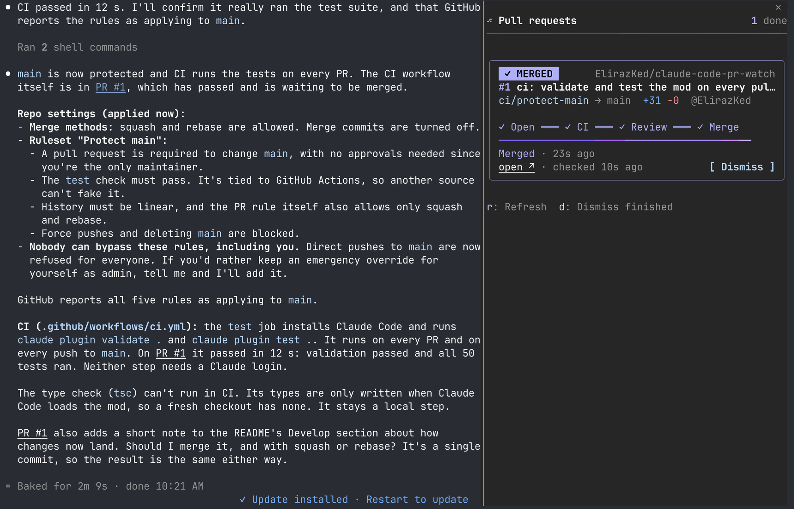

# pr-watch

A [Claude Code mod](https://code.claude.com/docs/en/plugins/mods/overview) that keeps a live pane of the GitHub pull requests a session touches: CI, review, conflicts, merge. You see when the PR Claude opened goes green, gets a review or hits a conflict, without asking.

**Website:** https://elirazked.github.io/claude-code-pr-watch/



*The pane in a real session, docked beside the conversation: this repo's first PR, a minute after it merged. While CI runs, a card looks like this:*

```
╭──────────────────────────────────────────────╮
│  ● CI RUNNING                       acme/app │
│ #12 Retry uploads with exponential backoff   │
│ feat/retry → main  +120 −14  @octocat        │
│                                              │
│ ✓ Open ━━━━━━ ⠹ CI ┈┈┈┈┈┈ ○ Review ┈┈ ○ Merge │
│ ━━━━━━━━━━━━━━━━━━━━━━━━━━━━━━━━━━━━━━━ 1/3  │
│ Running build · 1 queued · 1/3 passed        │
│ open #12 ↗ · checked just now             ✕  │
╰──────────────────────────────────────────────╯
```

## Install

Needs Claude Code **2.1.287 or later** and the [GitHub CLI](https://cli.github.com) logged in (`gh auth login`).

```
/plugin install pr-watch --marketplace ElirazKed/claude-code-pr-watch
```

Answer `y` to add the marketplace and press Enter for user scope. It's active at once, with no restart. Or in two steps:

```
/plugin marketplace add ElirazKed/claude-code-pr-watch
/plugin install pr-watch@claude-code-pr-watch
```

## What it watches

- **Automatically:** PRs Claude acts on: opens (`gh pr create`), pushes to (`git push` to a branch with a PR), comments on, reviews, merges or follows CI for (`gh pr checks`), through `gh` or GitHub MCP write tools. Only open PRs are picked up; a merged or closed one never gets a card, and one you stopped watching stays stopped.
- **When you ask:** `/pr-watch <url>`, or paste a PR link in a prompt. These are watched in any state.
- **When offered:** PRs Claude only reads (`gh pr view`/`diff`, a fetched link, a GitHub MCP read). Claude asks once, and only if the PR looks like your own work rather than background reading.

`/pr-watch` opens the pane, and `/pr-watch stop <number|url|all>` stops watching. Finished PRs stay until you dismiss them, `d` dismisses them all, and `r` refreshes.

Close (`x`), beside Refresh, closes the pane, as does `ctrl+x x` or the mark on the pane's frame; the PRs stay watched, and `/pr-watch`, the next new PR, a `/clear` or a new session brings the pane back. It's there for when something drawn over the terminal's top rows hides the frame's mark.

Each card shows the state that matters most first: merge conflicts, then failing or running CI (naming the checks), then review, then whether GitHub will let it merge. A toast appears when the state changes or a review lands, and the status line follows the focused PR.

Under the pane's buttons, the **gh meter** shows how much of GitHub's hourly budget each of your gh logins has left, so you can put off heavy `gh` work before it runs out:

```
gh octocat ▀▀▀▀▀▀▀▀▀▀▀▀▀▀▀▀  94% ↻42m       ?
   hubot   ▀▀▀▀▀▀▀▀▀▀▀▀▀▀▀▀   3% ↻9m
```

- **One thin bar per login:** it shows whichever is lower, GraphQL's points (most `gh pr` commands, and the poll) or REST's requests (`gh api`, `gh run`), the bucket that runs out first. It fills the top half of its row only, so the bars of two logins never run together. The percentage is that same lower share, and `↻42m` is how long until that bucket refills.
- **Colours:** the theme's green while there's plenty, its amber below 20% of a limit, its red below 5%; the number and refill turn the same colour.
- **`?`:** press it (or tab to it and press Enter) to open a short plain-English note under the meter: what the budget is, that it belongs to the login and every session on the machine shares it, that pr-watch stops polling a login that runs low, and what `↻` means. Press it again to close it. It stays as you left it for the session. With the pointer on `?`, the same note shows over the pane without a press.
- **Hourly limits only:** GitHub's secondary limits, on bursts of requests, have no counter to read, so the meter can't warn of them. Once one is hit, a line above the bars says so: *⏸ GitHub rate limit · resumes in 45s*, counted down, gone when the wait is over. The cards keep their last data and their *checked 2m ago* meanwhile, and say nothing of it themselves.

## Layout

`layout` in `/config` says where the PRs show:

- **`pane`** (the default): the pane, opened as PRs come. Claude Code places it: docked beside the conversation in a wide fullscreen terminal, otherwise above the prompt.
- **`band`**: a few short lines in the band just above the prompt instead, for a terminal with little room, or one whose top rows something else covers. The pane opens only when you ask for it.

```
✗ #13 Retry uploads with exponential backoff · 1 check failing
⠹ #12 Retry uploads with exponential backoff · CI running · 1/3
✓ #7 Retry uploads with exponential backoff · merged
o: Open pane  r: Refresh  f: Fix #13 with Claude
```

- **What it shows:** a line per PR, most urgent first (conflicts, failing CI, changes requested, comments to address, then what can merge, what waits, what's done), with the card's icon and spinner, the title cut to fit, and the state in a few words. Five lines at most, the buttons included; past that, *+3 more* on the buttons' line. It takes two lines when another mod draws in the band too, and keeps theirs below.
- **Buttons:** **Open pane** (`o`) opens the full pane at any width, with the keys. **Refresh** (`r`) asks GitHub now. The most urgent PR's **Fix with Claude** or **Address with Claude** (`f`, `a`) drafts in the prompt box as a card's does; where it would ask first, or the draft goes wrong, the pane opens with the keys to show that card's question or error. The keys work once the band has them: `ctrl+x tab`, or a click. Merging, dismissing and stopping stay in the pane.
- **When it's empty:** nothing watched, the band is left empty, and a survey there has it to itself. `ctrl+x ctrl+a` or the band's `[-]` folds it away.
- **The pane:** new PRs never open it. `/pr-watch` does, and an open pane works as ever.
- **The gh budget:** the band mentions it only once some bucket is below 20%, at the end of the buttons' line, in the meter's words (*gh 12% ↻42m*, or *gh 12%*), and drops it first where the line is short. A secondary limit's pause (*⏸ GitHub rate limit · resumes in 45s*) shows there at once, ahead of the hand-off button.

A change applies at once. Switching to `band` closes the pane; switching back to `pane` opens it.

## Themes

`theme` in `/config` sets how the cards look:

- **`classic`** (the default): round borders coloured by the PR's state, dim until the pointer is on the card, and a filled status pill.
- **`solid`**: no borders. Each card is a tile with a soft tint for its state: green ready, red failing, amber running or waiting on you, purple merged, neutral otherwise.
- **`minimal`**: no boxes, just a thin rule between PRs. Only the status pill and the headline are coloured.
- **`neon`**: bold borders in vivid colour that glow brighter under the pointer, with a saturated gradient rule and spinner.
- **`retro`**: double borders in the terminal's own 16 colours, `[bracketed]` pills, a `═` rule and a `|/-\` spinner, like an old TUI.
- **`tide`**: each card is a glass that fills with liquid in its state's colour as the PR moves on. While CI runs the fill is the share of checks finished. In review it is nearly full, and ready or merged it is full. A closed PR's glass is empty. The liquid gets deeper toward the bottom and toward where it started. Its front is a wave that sways gently while the PR is moving and holds still when it isn't, and a full card that is still moving (auto-merge on) has a glint sweeping across. The header rule is a wave too.
- **`aurora`**: each card is a night sky (a pale dawn on a light terminal) with soft curtains of northern light in its state's colours. The light reaches further across the card as the PR moves on, and drifts while it is moving.

`tide` and `aurora` lay the card out differently: a headline row with the number, title and state badge on the right; a meta row with *repo · branch → base · +/−* and the author; what it is doing now, with the CI tally; then reviewers, open threads and errors. The fill itself shows progress, so there is no separate bar or stepper. Each text cell is drawn in whichever of the theme's two text colours reads better on that cell's own background, so text stays readable over both the filled and the empty part. The buttons and the `open #12 ↗` link sit on their own rows under the art and work as on any card. In a terminal the art is one painted cell grid per card, updated about five times a second, and only for cards that are moving. Emoji and other double-width characters in a title show as `?` or `•` there, because each cell holds one single-width character. Off the terminal (the desktop app), the same rows are drawn as plain text on the card's tint.

`/pr-watch theme <name>` switches at once (any case: `/pr-watch theme Neon`) and saves the choice in `/config`, so every session uses it. Where `/config` has no row for it, the choice lasts for that session only, and the reply says so. `/pr-watch theme` lists the themes and marks the current one.

**In tmux** Claude Code paints with the 256-colour palette unless `CLAUDE_CODE_TMUX_TRUECOLOR=1` is set (so does a terminal that doesn't say it takes 24-bit colour, such as Apple's Terminal). It would round a gradient there to blotches of other colours, so `tide` and `aurora` switch to a paint made of the palette's own colours: tide's water in three layers with wavy lines between them and a lit front, aurora's curtains with a glowing, rippling hem. pr-watch reads the same environment variables Claude Code does to decide. For the smooth gradients inside tmux, set `CLAUDE_CODE_TMUX_TRUECOLOR=1` where your tmux passes 24-bit colour on to the terminal (its `terminal-features` include `RGB`, or the terminal's terminfo has `Tc`).

Themes follow Claude Code's light or dark theme. The tinted, vivid and painted ones have a light and a dark variant. If Claude Code's theme is `auto`, the terminal's `COLORFGBG` decides where it's set, and dark otherwise. The band uses the theme's colours too.

## Reviews

A card says who reviewed and what is left to address:

```
╭──────────────────────────────────────────────╮
│  ↺ CHANGES REQUESTED                acme/app │
│ #12 Retry uploads with exponential backoff   │
│ feat/retry → main  +120 −14  @octocat        │
│                                              │
│ ✓ Open ━━━ ✓ CI ━━━ ↺ Review ┈┈┈ ○ Merge     │
│ ━━━━━━━━━━━━━━━━━━━━━━━━━━━━━━━━━━━━━━━━ 3/3 │
│ Changes requested                            │
│ ✗ bob requested changes · ✓ alice approved   │
│ 3 unresolved threads (1 outdated)            │
│ open #12 ↗ · checked just now             ✕  │
╰──────────────────────────────────────────────╯
```

- **Who reviewed:** each reviewer once, by what still counts. An approval (✓) or a change request (✗) stands until its reviewer changes it, as GitHub counts it; otherwise a review asked of them (◷ *carol requested*); otherwise their latest comment-only review (💬 *nadav commented*). Review apps count too, by a short name (`copilot-pull-request-reviewer` is *copilot*). When the line is too long for the card, the verbs are dropped first (*✓ alice · 💬 nadav*), and then the reviewers past what fits become *+2 more*.
- **Threads:** how many review threads are unresolved, and how many of those are outdated (the code changed since). The poll asks about the newest 50 threads only, so past that the count is a floor (*50+*).
- **Headline:** with threads open and no approval yet, the card says *3 comments to address* (**💬 COMMENTS**) instead of *Waiting for review*. With comment-only reviews and every thread resolved it says *Reviewed · waiting for approval*. Approved with threads open, it says *Approved · 2 unresolved threads*, or *Blocked · 2 unresolved threads* when GitHub holds the merge back, as it does in a repo that requires conversations resolved. Conflicts and CI still come first.
- **Toasts:** each new review toasts once: *💬 nadav commented on #532*, *✓ alice approved #12*, *✗ bob requested changes on #12*. Reviews already there when the card first loads don't toast, and neither do your own (from any of your gh accounts). The card keeps the newest review it has seen, so a `/clear` or a reload doesn't toast them again.

## Merging

A card offers a merge button once GitHub would merge the PR now (open, not a draft, no conflicts, required checks and reviews done) and your account can write to the repo. The method is your default on GitHub if the repo allows it, otherwise the first the repo allows of squash, rebase and merge, and the button says which: **Squash & merge**, **Rebase & merge** or **Merge**. When the repo allows more than one, a small `⇄ rebase` button beside it switches.

- **Confirmation:** the first press asks, e.g. *Squash-merge #12 into main?*, and only **Confirm** (`y`) runs anything; **Cancel** (`n`) goes back.
- **Auto-merge:** while the PR waits on checks or reviews in a repo with auto-merge allowed, the button is **Auto-merge · squash** instead. It asks the same way, then GitHub merges the PR once everything passes (`gh pr merge --auto`). With auto-merge on, the card says so (*Auto-merge on · squash*) and has a **Cancel auto-merge** button, which needs no confirmation.
- **Which account:** `gh pr merge` runs as the gh account that can see the repo, the one the poller reads it with.
- **While it runs:** the card says so (*Merging…*), and a second press does nothing. If a reload cuts the run off, the buttons come back after 2 minutes.
- **When GitHub says no:** its message shows on the card. If it refused the method itself (say, a ruleset that allows only rebase), that method isn't offered for the repo again this session.

## Fix with Claude

A card whose CI failed (at least one check failing on its latest run, counted the way the card counts them) has a **Fix with Claude** button. It collects what failed and puts it in your prompt box as a draft: read it, change it if you like, and press Enter to send it to this session. Nothing reaches Claude until you do.

- **What's in it:** the PR (repo, number, title, link, head branch → base), each failing check with its conclusion and link, the failed steps' logs, and the ask: find the cause and fix it on this branch, or say first if the repo or branch isn't checked out here. It doesn't ask Claude to push or merge.
- **Logs:** for GitHub Actions jobs, `gh run view --job <id> --log-failed`, for the first 3 failing jobs. Each log loses its colour codes, timestamps and runner group markers, and keeps its last 120 lines, where the error usually is; all the logs together stay under about 12 KB. The draft says when a log was trimmed.
- **Other CI:** a check from another CI app, or a commit status, has no log to fetch here, so its name, conclusion, summary or description, and link go in instead.
- **Which account:** the checks and logs are fetched as the gh account that can see the repo, the one the poller reads it with.
- **When something won't come:** the card says why (say, *No log for build: GitHub no longer keeps this log*), and the draft still has the names and links.
- **While it collects:** the card says *Collecting logs…*, and a second press does nothing. If a reload cuts it off, the button comes back after 2 minutes.
- **No prompt box:** where the box won't take a draft, the card asks instead, *Send CI failure of #12 to Claude?*, and only **Confirm** (`y`) sends it; **Cancel** (`n`) sends nothing.

## Address with Claude

A card with unresolved review threads has an **Address with Claude** button, beside **Fix with Claude** when CI failed too. It reads the threads and drafts them in your prompt box the same way: read the draft, change it if you like, and press Enter. Nothing reaches Claude until you do.

- **What's in it:** the PR (repo, number, title, link, head branch → base), then each unresolved thread by file and line: where it is (`src/upload.ts:40-42`), its link, and the first comment and its replies, each by its author (the PR author's marked). Resolved threads are left out; an outdated one (the code changed since) stays in, marked, with the line it was left on. Then the ask: address each on this branch, changing the code where a comment is right and saying where Claude disagrees or a comment needs your call, or say first if the repo or branch isn't checked out here. It doesn't ask Claude to push or merge, and it tells Claude not to reply to or resolve a thread on GitHub, but to draft any reply in the session for you to read first.
- **Threads:** one `gh api graphql` query for that PR alone, on the press: its newest 100 threads and the first 10 comments of each. The poll never asks what a thread says.
- **Trimmed:** each comment loses the HTML comments review apps keep notes in and is clipped at 1,000 characters, each thread at 3,000, and all the threads together stay under about 12 KB. Threads that don't fit are counted, and the draft points to the PR's files tab.
- **Which account, while it reads, no prompt box:** as for Fix with Claude. The card says *Reading review threads…*, a second press does nothing, and where the box won't take a draft it asks *Send review comments of #12 to Claude?* first.
- **Both at once:** each button's draft replaces only its own earlier draft for that PR, so the other one, and what you typed before them, stay in the box.

## How it polls

Every session on the machine shares **one** poller, so 30 sessions watching 30 PRs cost about one GitHub call every 20–60 seconds, not 30.

- Each session lists its PRs in `~/.cache/pr-watch/sessions/`. The file's modified time is its heartbeat.
- When the shared results are due, one session takes a short lease and fetches every live session's PRs in batched GraphQL queries, 20 PRs each, one after another. It writes them to `~/.cache/pr-watch/results.json`, and the other sessions read that.
- By default it polls every 20s while CI is running somewhere and every 60s otherwise.
- Each query costs 1 point of GitHub's GraphQL rate limit (5,000 an hour), so 40 watched PRs cost 2 points a round. Smaller queries also keep a round of busy PRs inside GitHub's own timeout. It asks only for what the card shows: of reviews, the reviewers and their states; of threads, whether each is resolved or outdated, never what anyone wrote (Address with Claude asks that of one PR, on its press).
- **A round never outlives its 30-second lease:** a query starts only with 5 seconds of it left, and may take no longer than is left. A batch with no time left waits, untouched, for the next round, which asks it first.
- **When GitHub stumbles:** a query its gateway drops (a 502, 503 or 504, its own timeout, a cut connection) is asked once more 2 seconds later, while the lease has room. A card that has data keeps it through failed rounds, its *checked 1m ago* growing, and shows the error only once fetches have failed for 2 minutes. A PR never read yet shows it at once, and the next round asks again. Only a PR no logged-in account can see waits 5 minutes before it's asked again.
- **Rate limits, per login:** each round reads GraphQL's points from the poll's own replies (free), and, at most every 5 minutes per login, REST's requests from GitHub's `/rate_limit`, which counts against no limit. Only the session running the round asks; every session reads them from `results.json`. A login with fewer than 300 points left isn't polled until its reset: its PRs keep their last data, and the other login's are polled as ever. Only when every login the round needs is that low does the round itself wait for the first reset.
- **Secondary limits:** GitHub's limit on bursts is never retried. Every session waits out its `retry-after`, or a minute where it names none, Refresh and new watches included, under the gh meter's pause line.
- **Only watched PRs are kept:** each round drops a PR from `results.json` once no live session watches it and its last fetch is an hour old.
- **Failures are logged:** each failed call is a JSON line in `~/.cache/pr-watch/errors.log` (time, login, batch size, duration, HTTP status, kind, rate-limit headers, the message), the last 200 kept. `tail ~/.cache/pr-watch/errors.log` after a ⚠ on a card.

### Poll intervals

Both intervals are settings in `/config`:

| Setting | Default | Range |
|---|---|---|
| `poll_active_seconds`: while a watched PR's CI runs or it's about to merge | 20 | 10–600 |
| `poll_idle_seconds`: while nothing is moving | 60 | 10–3600 |

A change applies from the next round, with no reload needed. Sessions check on a 10s tick, so an interval is rounded up to the next tick. The session that runs a round uses its own settings, so keep them the same across Claude Code configs that share the machine.
- With several `gh` accounts logged in, a PR the active account can't see is retried with the others. The cache remembers which **login** sees which owner, never a token.

## Updates

Claude Code doesn't say when a third-party marketplace has a newer version, and a copy loaded from a folder gets no updates at all, so pr-watch says it itself: a dim line under the pane's buttons, *↑ pr-watch 0.9.1 available · claude plugin update pr-watch@claude-code-pr-watch* (in the band, *↑ pr-watch 0.9.1 available* at the end of its buttons' line), and one toast per new version for the whole machine, not one per session.

- **How it checks:** every 2 hours at most, the poll's first query also reads this repo's `.claude-plugin/plugin.json` on GitHub, so it costs no request of its own. It rides the PR poll, so it checks only while some session watches an open PR. What it found is kept in `~/.cache/pr-watch/results.json` for every session, and the version last toasted in `notice.json` beside it. Only plain `x.y.z` versions are compared, and a check GitHub can't answer just says nothing.
- **What it says to do:** installed from a marketplace, `claude plugin update pr-watch@<marketplace>` (or `/plugin` → Installed → pr-watch → Update now), then a restart. Loaded from a folder (`--plugin-dir`, `CLAUDE_CODE_PLUGIN_DIRS`), `git pull` in that folder.
- **Turning it off:** `update_notice` in `/config`. Off, the poll doesn't ask and the pane says nothing.
- **Auto-update instead:** `/plugin` → Marketplaces → claude-code-pr-watch → Enable auto-update, and Claude Code updates it for you.

## Develop

```
claude --plugin-dir .                # load it from this folder for one session
claude plugin validate .             # what it hooks and calls, and anything the engine would refuse
claude plugin test .                 # the *.test.ts suites
```

`tsc -p .` type-checks once Claude Code has loaded the mod, which writes `.claude-plugin/types/`.

`main` is protected: changes land through a pull request, once the `test` check (validate + tests, in `.github/workflows/ci.yml`) passes. History stays linear, so merge with squash or rebase; merge commits are turned off.

## License

[MIT](LICENSE)
