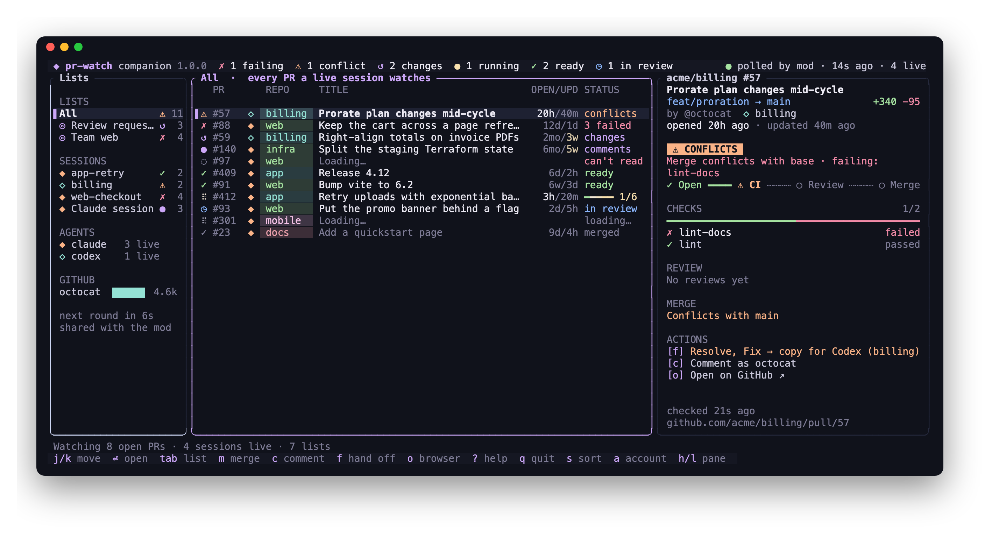

# prw

`prw` is a full PR manager for the terminal: all your PRs in one place. Your own open PRs, your saved
GitHub searches and every PR your agents touch (Claude through the pr-watch mod; Codex and others
through `prw mcp` or `prw watch`), in a responsive TUI with a full PR view (conversation, threads,
checks, files) to reply, resolve, approve and merge in, so GitHub can stay closed. It runs on its own,
with or without Claude; the mod stays complete without it, and when both run they share one poll.



Your sessions' PRs come from the mod's shared
cache (`PROTOCOL.md`): a list of all of them, one list per live session (Claude through the mod;
others by the `agent` their session file names), each PR's card worked out as the mod does
(`prw-core`, held to the mod's own fixtures in `fixtures/`). It also finds every open PR each of your
gh logins authored and shows them as "My PRs", and a list for each GitHub search you save (below), so
it is of use without Claude running at all.

It takes part in the poll as one more session. It announces "My PRs" in its own session file, so a
running mod fetches them in its rounds. When no mod is polling, it polls GitHub itself, for every live
session, under the same lease, rate limits and hold as the mod. The header says who polled last.
`--no-poll` keeps it to reading: it never writes to the cache, and asks GitHub only when you act on a
PR.

On the selected PR, `m` merges, `c` comments, `f` hands it off and `o` opens it in the browser
(below). Each goes as the gh login that sees the PR's repo (the one the poll uses), with that login's
own token, whichever login `gh` has active. After a merge or a comment the PR is fetched again at
once, so its card is current before the next round.

- **Which login:** with more than one gh login, the PR's details say which it goes as ("as hubot"),
  and `a` moves its owner to the next one: written to `results.json`'s `accounts`, so the mod goes as
  it too, and the PR is fetched again at once as that login. A fetch then keeps it, unless that login
  can't see one of the owner's PRs (the poll asks the others, as ever).

- **Merge** asks first on the bottom line: "Squash-merge #409 into main?", `y` to merge, `m` for the
  repo's next allowed method. Where GitHub won't merge yet, it offers auto-merge instead, and cancels
  one already on. A method the repo refuses is skipped next time; a server error is retried once, after
  checking whether the merge went through.
- **Comment** opens a field on the bottom line: Enter posts, Alt-Enter is a new line, a paste goes in
  whole, Esc cancels. A post that fails keeps the text for the next `c`. The text goes to `gh` on
  stdin, never in its arguments.
- **Hand-offs** copy a prompt for the agent that runs the PR, as the mod drafts it: Resolve (conflicts
  with the base), Fix (failed checks, with the tail of each failed job's log) or Address (the open
  review threads, each comment cleaned of markup). With more than one, `f` asks which. The toast says
  how it was copied: `pbcopy` on macOS, `wl-copy`, `xclip` or `xsel` on Linux, OSC 52 over SSH or where
  none works. OSC 52 can't confirm the copy, so `v` shows the prompt last copied, to select by hand.

### The full PR view

Enter (or a click on the selected row) opens the PR full size: its title, pill and branch on top,
three tabs below, and at full width its card beside them. Esc goes back to the lists.

- **1 Conversation:** the description, then every comment, review and review thread in the order
  they were left. A thread shows the code it is on and its comments; a resolved one folds to a line
  until it is selected. It opens on the first open thread.
- **2 Checks:** the latest run of each check, failed first, with how long it took. Under each failed
  GitHub Actions job, the end of its log (the first three jobs' logs are read, as Fix reads them).
  A PR whose CI failed opens here.
- **3 Files:** each changed file with its counts, and under the selected one the threads left on it.

What people write (the description, comments, reviews, thread comments) shows as GitHub shows
markdown, by [tui-markdown](https://github.com/joshka/tui-markdown) in prw's colours: headings bold,
links underlined (their address left out), tables boxed to the width, code on its own ground, tasks
ticked, `@someone` and `#123` in the accent, HTML tags left out (a `<details>` summary shows as `▸`).

From it you can act on what you read, each as the gh login that sees the repo:

- **`r` replies** to the review thread selected: the field on the bottom line says where it goes
  ("reply on src/upload.ts:42"). Off a thread, `r` comments on the PR, as `c` does.
- **`x` resolves** the thread selected, or reopens one already resolved. It asks nothing first:
  `x` again undoes it.
- **`a` approves** the PR, after a `y`, with no text. Your own PR, or one not read yet, says why
  not instead. In the lists `a` still switches the login.
- `m`, `c`, `f`, `R`, `X` and `o` act on the open PR as they do in the lists.

The text of a reply goes to gh on stdin as a GraphQL variable, never in argv. A reply that didn't
post comes back with `r` on its thread (a comment's with `c`), and what GitHub said shows on the
status line.

The PR is read in one GraphQL call when it opens and every 30 s while it shows (not while GitHub
has said to wait), and again at once after anything done from it: a merge, a comment, a login
switch, a reply, a resolve or an approval, refused or not, so a thread that moved on meanwhile shows
as it is now. Each failed job's log is read once. The poll never reads any of it. In the demo,
`demo/full/` holds what four of its PRs read as (#93 is someone else's, to approve).

Agents other than Claude watch PRs through `prw mcp` (a tool server with the mod's `watch` tool) or
`prw watch <url>`. Each agent's session gets a list of its own, as a Claude session does (below).

## Install

The latest release (macOS and Linux, x86_64 and arm64; Linux builds are static) to `~/.local/bin`,
or `$XDG_BIN_HOME` where that is set:

```sh
curl -LsSf https://github.com/ElirazKed/claude-code-pr-watch/releases/latest/download/prw-installer.sh | sh
```

Or with nix, or cargo (Rust 1.88 or newer):

```sh
nix run github:ElirazKed/claude-code-pr-watch#prw      # or nix profile install …#prw
cargo install --locked --git https://github.com/ElirazKed/claude-code-pr-watch prw
```

Each release's archives come with checksums and a GitHub attestation:
`gh attestation verify prw-aarch64-apple-darwin.tar.xz --repo ElirazKed/claude-code-pr-watch`.
`prw` needs the [GitHub CLI](https://cli.github.com) logged in (`gh auth login`); without it, the
status line says which is missing. Releases are cut by pushing a `prw-v<version>` tag
(`dist-workspace.toml`).

## Build and run

With nix (flakes), from the repository root:

```sh
nix run .#prw                              # build and run, reading ~/.cache/pr-watch
nix run .#prw -- --cache companion/demo --demo   # the demo cache (below)
nix build .#prw                            # ./result/bin/prw
nix develop                                # cargo, rustc, clippy, rustfmt, rust-analyzer
cd companion && cargo run -p prw
```

Without nix, any recent stable Rust (1.88 or newer):

```sh
cd companion
cargo run -p prw -- --cache demo --demo
cargo test --workspace
```

`--cache <dir>` (or `PRW_CACHE`) uses another cache directory than `~/.cache/pr-watch`. `prw` runs
`gh` from `PATH`, as each login (`gh auth token --user`), and never switches gh's active account.

### Saved searches

Each search in `~/.config/prw/config.toml` is a list of its own, beside All and My PRs:

```toml
[[search]]
name = "Review requests"
query = "is:open review-requested:@me"

[[search]]
name = "Team web"
query = "is:open repo:acme/web"
login = "octocat"   # only as this gh login; else as each, their finds together
```

The query is what you would type in GitHub's search box; `is:pr` is added where it doesn't say. Each
list shows at most 30 PRs, and its title says how many match in all ("4 of 112"). With no
`config.toml`, there is one list, "Review requests" as above; an empty file has none. The file is read
again when it changes, and a file that won't read, or a search with no name or query, is said on the
status line. At most 10 searches run.

Searches run with the "My PRs" search, every minute, in one call per gh login (a point a search). A
login low on points waits, keeping what it found. What they find is announced in a file of its own
(`sessions/prw-<id>-searches.json`, `"kind": "searches"`), so the poll fetches those PRs as it does
any session's. They stay out of All and the header's counts, which are your sessions' PRs.
`--config <file>` (or `PRW_CONFIG`) reads another file; `$XDG_CONFIG_HOME/prw/config.toml` is used
where that is set. `--no-poll` and `--demo` run no search (the demo shows `demo/searches.json`).

### Versions

prw has a version of its own, apart from the mod's: `prw --version`, the header (three panes) and the
key help say it. Every two hours at most, prw reads `companion/Cargo.toml` on this repo's default
branch (one `gh api` call, as any login), and when a newer prw is out a toast says so once, and
then the status line (while it says nothing else) and the key help (`↑ prw <version> is out`).
`check_version = false` at the top of `config.toml` turns it off; `--no-poll` and `--demo` never ask.

### The demo cache

`demo/` is a hand-made cache: a `results.json` of acme/* PRs built from the status fixtures (CI
running, failed, conflicts, changes requested, comments to address, in review, ready, merged; one PR
no gh account could see, one whose fetches have failed for a while) and four session files: two
Claude sessions (`app-retry`, `web-checkout`), a Codex session written by `prw` (`billing`), and an
older mod's file with only `urls` (listed as "Claude session"), which also watches a PR not read yet.
`searches.json` is two saved searches as if searched, which `--demo` lists.

Its files never change, so a session would read as dead (a session file is live while its mtime is
under 60 s old) and the results as hours old. `--demo` shows it as if it were live: every session file
counts as just written, the clock starts 12 s after the results' round, and nothing polls. Without
`--demo`, touch the session files first (`touch companion/demo/sessions/*.json`) and the header says
how old the results really are (and pass `--no-poll`, or `prw` polls GitHub for the demo's PRs).

### Watching for other agents

```sh
prw watch https://github.com/acme/app/pull/12          # in this folder's session, as this agent
prw watch <url> --agent codex --session billing         # named
prw watch                                               # what is watched, by session
prw unwatch <url>                                       # everywhere (--session/--agent: just there)
prw unwatch --all --session billing
```

The agent is `--agent`, else `$PRW_AGENT`, else `claude` or `codex` where `prw watch` runs inside
one, else `cli`. The session is `--session`, else the current folder's name; a session named by its
folder is that folder's (two projects in folders of one name are two sessions), and one named with
`--session` is one session wherever it is watched from. A watch lasts until it is unwatched, or its PR
has been merged or closed for an hour. While a `prw` TUI runs, every agent's session with a watch is
listed and polled; with none running, a `prw watch` session is polled for a minute (a running
`prw mcp` keeps its own going), and `prw watch` says so.

`prw mcp` serves the same over MCP on stdio, for any agent that takes MCP servers: a `watch` tool
(the mod's name and `urls` argument) and an `unwatch`, in the agent's session (its agent from
`--agent`, else the MCP client's name; its session from the folder the agent starts it in). For
Codex:

```sh
codex mcp add prw -- prw mcp
```

or in `~/.codex/config.toml`:

```toml
[mcp_servers.prw]
command = "prw"
args = ["mcp"]
```

Then a line in the project's `AGENTS.md` makes it a habit: "When you open or push to a pull request,
ask whether to watch it in prw, and call prw's `watch` tool with its URL if the user agrees."

### Keys

| key                  | does                                                         |
|----------------------|--------------------------------------------------------------|
| `j` `k`, `↓` `↑`     | the next or previous PR (or list, in the lists pane)         |
| `g` `G`, Home End    | the first or last                                            |
| Enter                | open the PR full size                                        |
| Tab, Shift-Tab       | the next or previous list                                    |
| `h` `l`, `←` `→`     | three panes: the lists pane or the PRs; narrower: the previous or next list |
| `m`                  | merge the PR, or turn auto-merge on (or off) where it waits on checks or review, after a `y` (`m` again: the next method); the bottom row says which |
| `c`                  | comment on it                                                |
| `f`                  | hand it off: copy the Fix, Resolve or Address prompt         |
| `R`                  | run its failed or skipped GitHub Actions checks again, after a `y`: a run with a failed job gets its failed jobs (and those waiting on them), one with only skipped jobs runs again whole. A job its own `if:` skipped skips again. In the full view's Checks tab, `R` on a failed or skipped check starts that job alone (with the jobs that wait on it), as GitHub's Re-run job does: the way to start a job its `if:` keeps for a later attempt (`github.run_attempt > 1`). The card and the Checks tab show a skipped check as `⊘ skipped` |
| `X`                  | close the PR, or reopen a closed one, after a `y`            |
| `o`                  | open it in the browser                                       |
| `s`, `S`             | order the lists: most urgent first, by repo, oldest first, quietest first; `S` turns the order around |
| `a`                  | switch the gh login its owner's PRs go as (with two or more); in the full view, approve |
| `v`                  | show the prompt last copied (`j` `k` scroll, Esc closes)     |
| `?`                  | the key help                                                 |
| `q`, Esc, Ctrl-C     | quit (Esc closes the help, a question or the field first)    |

In the full view, `j` `k` (and `g` `G`) move through the tab's items, `1` `2` `3` pick a tab, Tab
and Shift-Tab (or `h` `l`) the next or previous one, and Esc or Backspace go back. `r` replies to
the thread selected (elsewhere it comments), `x` resolves or reopens it, and `a` approves after a
`y`; the other action keys are as above.

The mouse works too. A click picks a list or a PR (a second click opens it), a tab or an item of
the full view, or presses the key it shows: a hint on the
bottom row, an action on the card, an answer to the question on the status line (while a question
is open, only its answers take clicks). The wheel moves in the pane under it. While `v` shows the
prompt, prw lets go of the mouse, so a plain drag selects the prompt's text; elsewhere most
terminals select with Shift (iTerm2: Option) held.

## Layout

The screen adapts to the terminal's width (`prw_core::layout`, and `prw_core::panes` for where each
pane goes):

| width (columns) | layout        | shows                                                         |
|-----------------|---------------|---------------------------------------------------------------|
| 100 and up      | three panes   | the lists, the PR table and the selected PR's card side by side |
| 60 to 99        | strip         | the lists as a strip on top; the table and the card below, side by side |
| 40 to 59        | side          | one list (Tab for the next), the table, and a short card under it (beside an agent) |
| under 40        | too narrow    | "prw needs 40 columns"                                        |

The full view keeps the header, the status line and the hints, and puts the PR in between: at full
width with its card beside it, narrower alone.

The cut-offs sit between the design's reference widths (120, 84 and 49 columns), so each lands well
inside its own band. A wider terminal never gets a smaller layout.

Each row wears a chip in its repo's colour, with the repo's name (and its owner too, where two repos
share a name); a repo keeps its colour across runs. Where the table has room, two columns say how
long ago the PR was opened and last updated: a PR opened in the last day is bright, and one with
nothing new for two weeks turns yellow. Narrower, the two share a cell (`3mo/2d`); narrower still,
the card says them. The dates need pr-watch 0.14.2 or prw to have polled the PR.

A PR with something under way (CI running, GitHub still computing, a first fetch) turns the mod's
spinner in the table and on its card's step, and a glint runs along the checks bar's pending part;
a job prw runs (a merge, a comment) spins on the status line. A PR whose status changes glows in
its new colour for a moment, a PR new to the lists wipes in, and a toast fades out at the end of
its time. prw draws a frame every 90 ms only while something on screen moves, and otherwise only
when something changes.

## Crates

- `crates/prw-core`: the pure kernel (no I/O, no clock): protocol types, status logic, the layout, the
  TUI's model (`ui`: `update(Model, Msg) -> (Model, Vec<Cmd>)`) and the poll's decisions, ported from
  the mod (`poll`, `batch`, `accounts`, `rate`, `entries`, `search`), the saved searches (`config`),
  other agents' watches (`watch`),
  the MCP messages (`mcp`), and the actions (`act`: what each key asks and shows; `merge`, `comment`,
  and the hand-off prompts in `handoff`, `fix`, `resolve` and `address`), the full view (`full`: one
  PR read whole; `opened`: its tabs, selection and reads), tested with properties and against the mod's fixtures
  (`tests/fixtures.rs`).
- `crates/prw`: the binary: the terminal (ratatui), reading the cache (`cache.rs`), drawing the model
  (`view.rs`, the full view in `view/full.rs`), and the poller thread (`poller.rs`: a tick every 10 s; `round.rs`: asking GitHub; `gh.rs`:
  running `gh` and the clock, behind traits the tests fake), the actions (`actions.rs`: running each one as its own thread; `desktop.rs`: the clipboard and the
  browser), and the other commands (`cli.rs`: `watch`
  and `unwatch`; `mcp.rs`: the tool server; `watches.rs`: the watch files and their sessions).
